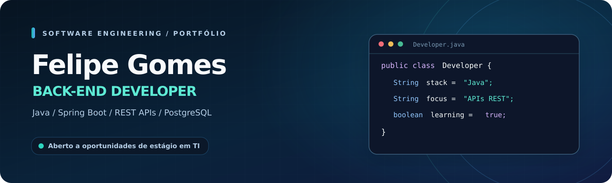

<picture>
  <source media="(prefers-color-scheme: dark)" srcset="./assets/hero-dark.svg">
  <source media="(prefers-color-scheme: light)" srcset="./assets/hero-light.svg">
  
</picture>

 

  

**Estudante de Ciência da Computação na UniFAJ** · 📍 Jaguariúna, SP, Brasil  
**Foco:** Java Back-end, APIs REST, modelagem de dados e desenvolvimento de software.

---

### 👨‍💻 Um pouco sobre mim

Sou estudante de **Ciência da Computação** e desenvolvedor Back-end em formação, com foco em **Java e Spring Boot**. Gosto de transformar ideias em sistemas: da modelagem do banco à criação de APIs e à integração com interfaces web.

Além dos estudos, desenvolvo projetos independentes para praticar **arquitetura de software, segurança, regras de negócio e aplicações SaaS**. Atualmente, procuro uma **oportunidade de estágio em desenvolvimento de software**, onde possa trabalhar em equipe, receber feedback técnico e evoluir profissionalmente.

- 🎓 **Formação:** Ciência da Computação — UniFAJ (2026–2030, previsão).
- 🔭 **Projetos em desenvolvimento:** PizzaSystem, CondoFlow e Orbitta.
- 🧩 **Interesses:** Java, Spring Boot, PostgreSQL, autenticação e integração entre serviços.
- 🤝 **Objetivo:** Estágio em Desenvolvimento Back-end / Desenvolvimento de Software.

### 🛠️ Tech stack

  

### 🚀 Projetos públicos em destaque

<table>
<tr>
<td width="50%" valign="top">

#### 🛒 [E-commerce API](https://github.com/fgscarvalho37-a11y/E-commerce-API)

API REST para gerenciar **produtos e pedidos**, com atualização de status, busca e organização em camadas.

`Java 21` `Spring Boot` `JPA` `H2`

<a href="https://github.com/fgscarvalho37-a11y/E-commerce-API">Ver código →</a>

</td>
<td width="50%" valign="top">

#### 🔐 [Auth API](https://github.com/fgscarvalho37-a11y/auth-api)

API de **cadastro, login e autenticação com JWT**, utilizando Spring Security e validação de dados.

`Java` `Spring Security` `JWT` `JPA`

<a href="https://github.com/fgscarvalho37-a11y/auth-api">Ver código →</a>

</td>
</tr>
<tr>
<td width="50%" valign="top">

#### 📦 [Inventory API](https://github.com/fgscarvalho37-a11y/inventory-api)

CRUD de produtos com filtros por **nome, categoria e preço**, separado em controller, service e repository.

`Java` `Spring Boot` `H2` `REST`

<a href="https://github.com/fgscarvalho37-a11y/inventory-api">Ver código →</a>

</td>
<td width="50%" valign="top">

#### 📊 [Sales Dashboard API](https://github.com/fgscarvalho37-a11y/dashboard-api)

API de vendas com **indicadores e agregações**, incluindo receita por categoria e por data.

`Java` `Spring Boot` `JPA` `H2`

<a href="https://github.com/fgscarvalho37-a11y/dashboard-api">Ver código →</a>

</td>
</tr>
</table>

<b>📚 Ver outros projetos de estudo</b>

 

| Projeto | Objetivo |
|:--|:--|
| [Scheduling API](https://github.com/fgscarvalho37-a11y/scheduling-api) | API REST para agendamentos, filtros e status |
| [FastAPI Service](https://github.com/fgscarvalho37-a11y/fastapi-service) | API de tarefas com Python e FastAPI |
| [ETL Automation](https://github.com/fgscarvalho37-a11y/etl-automation) | Pipeline de extração, transformação e exportação de dados |
| [Data Structures](https://github.com/fgscarvalho37-a11y/data-structures) | Lista encadeada, pilha, tabela hash e árvore AVL em C++ |
| [Algorithms](https://github.com/fgscarvalho37-a11y/algorithms) | Algoritmos de busca, ordenação e recursão em C++ |

### 🧩 Produtos autorais · Código privado

Os projetos abaixo são iniciativas independentes em evolução. Seus repositórios são privados por envolverem produtos e integrações comerciais; **não são projetos open source**.

| Projeto | O que estou construindo | Tecnologias principais |
|:--|:--|:--|
| **🍕 PizzaSystem** | SaaS multi-tenant para pedidos e operação de pizzarias, com cardápio, gestão e integrações | Java, Spring Boot, PostgreSQL, Next.js |
| **🏢 CondoFlow** | Gestão condominial para rotinas de síndico e portaria, com aplicação web e mobile | Java, Spring Boot, PostgreSQL, Expo |
| **🪐 [Orbitta](https://orbitta.space)** | Plataforma de produtos digitais, serviços de sites e gestão comercial | Java, Spring Boot, Next.js, TypeScript |

Funcionalidades e integrações podem estar em diferentes estágios de desenvolvimento. Projetos privados podem ser apresentados por meio de demonstrações apropriadas.

---

### ☕ Vamos conversar?

Estou aberto a **estágios em desenvolvimento de software**, principalmente com **Java, Spring Boot e APIs REST**.

  

Feito com curiosidade, código e vontade de aprender. · Felipe Gomes Carvalho

